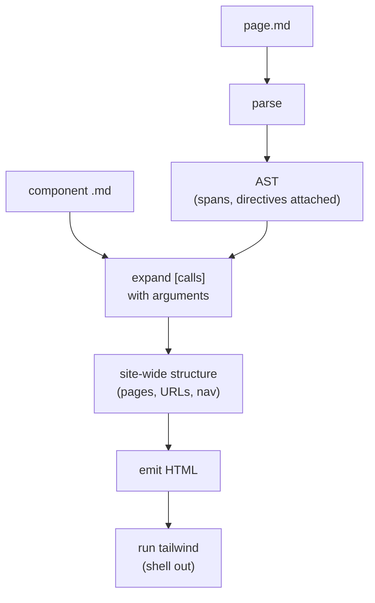

    <h1>Nostalgia</h1>

Customizable markdown, generate your site in an instant.

### Concept

Nostalgia was born from the lack of customizable site generation tools. 

API docs, landing pages and overall sites are usually a pain to maintain standardized, usually those are separated on different projects, that need to be maintained separately.

Nostalgia is here to join everything together in a single place, while keeping full customization and control to the user.

With Nostalgia, you write markdown, and it magically generates you a full working site, you can save your layouts to standardize your documentations and overall look of your sites.

### Design

